# Base « Résidence universitaire et son restaurant »

Modèle physique issu du MCD décrit dans `.claude/residence.md`, interrogé par les étudiants dans les exercices SQL.

- Source de données n°1 (champ `datasource` des utilisateurs et des exercices)
- DDL : `backend/src/main/resources/sandbox/residence/schema.sql` (portable H2 / MySQL)
- Données : `backend/src/main/resources/sandbox/residence/data.sql`, générées par `backend/tools/generate_sandbox_data.py`
- **Date de référence** du jeu de données : **29/09/2026**. Les repas postérieurs n'ont pas encore été servis
  (`reservation.present` vaut `NULL`) et les occupations en cours n'ont pas de `date_fin`.

## Diagramme

```mermaid
erDiagram
    batiment ||--o{ chambre : contient
    chambre ||--o{ occupation : "est occupée"
    etudiant ||--o{ occupation : occupe
    etudiant ||--o{ reservation : reserve
    repas ||--o{ reservation : "est réservé"
    type_repas ||--o{ repas : type
    menu ||--o{ repas : propose
    evenement |o--o{ repas : "repas spécial"
    menu ||--o{ composition_menu : compose
    plat ||--o{ composition_menu : "figure dans"
    type_plat ||--o{ plat : classe
    etudiant ||--o{ etudiant_contrainte : declare
    contrainte_alimentaire ||--o{ etudiant_contrainte : concerne
    plat ||--o{ plat_incompatibilite : "incompatible avec"
    contrainte_alimentaire ||--o{ plat_incompatibilite : exclut
    plat ||--o{ plat_ingredient : utilise
    ingredient ||--o{ plat_ingredient : "entre dans"
    fournisseur ||--o{ fournisseur_ingredient : propose
    ingredient ||--o{ fournisseur_ingredient : "est fourni"
    etudiant ||--o{ intervention : effectue
    tache ||--o{ intervention : "est réalisée"
    etudiant ||--o{ formation : "forme (formateur_id)"
    etudiant ||--o{ formation : "est formé (forme_id)"
    etudiant ||--o{ participation_evenement : participe
    evenement ||--o{ participation_evenement : mobilise
    evenement ||--o{ depense : genere
    depense ||--o{ avance_depense : "est avancée"
    etudiant ||--o{ avance_depense : avance
```

## Tables

| Section du sujet | Table | Contenu | Particularités |
|---|---|---|---|
| 1. Résidence | `batiment` | 4 bâtiments | |
| | `chambre` | 160 chambres | `capacite` de 1 à 3 |
| | `etudiant` | ~390 étudiants | Alice Martin, Bob Lefèvre, Charlie Dubois, David Moreau : chaîne de formation du sujet |
| | `occupation` | historique des chambres | `date_fin` NULL = en cours ; changements de chambre, départs et retours |
| 2. Repas | `type_repas` | petit-déjeuner, déjeuner, dîner, repas spécial | |
| | `repas` | ~860 repas (2025-2026 et rentrée 2026) | `evenement_id` renseigné pour les repas spéciaux |
| | `reservation` | ~49 000 réservations | `annulee`, `present` (NULL si repas à venir) ; places jamais dépassées |
| 3. Menus | `menu`, `composition_menu` | 34 menus | `ordre` des plats dans le menu |
| | `plat`, `type_plat` | 64 plats | quelques plats ne figurent dans aucun menu |
| 4. Contraintes | `contrainte_alimentaire`, `etudiant_contrainte` | 7 contraintes | Alice : végétarienne, allergie au lait ; « Allergie au poisson » n'est déclarée par personne |
| | `plat_incompatibilite` | | déduite des ingrédients (viande, porc, lait, gluten...) |
| 5. Ingrédients | `ingredient`, `plat_ingredient` | 52 ingrédients | `stock` parfois sous `stock_minimum` ; « Plat du chef » sans recette |
| 6. Fournisseurs | `fournisseur`, `fournisseur_ingredient` | 11 fournisseurs | prix variable selon le fournisseur ; `date_debut` parfois inconnue ; le safran n'a aucun fournisseur |
| 7. Personnel | `tache`, `intervention` | 6 tâches, ~5 400 interventions | uniquement par des résidents |
| 8. Formation | `formation` | association réflexive sur `etudiant` | `formateur_id` → `forme_id` ; quelques changements de formateur en cours de formation |
| 9. Événements | `evenement`, `participation_evenement` | 10 événements | un « Responsable de l'organisation » par événement ; la soirée jeux n'a pas de repas |
| 10. Dépenses | `depense`, `avance_depense` | | certaines dépenses ne sont pas (entièrement) couvertes par les avances |

Volumétrie totale : ~57 000 lignes (limite fixée : 100 000).
