# Base « Entreprise de transport de colis »

Modèle physique issu du sujet de MCD « Gestion d'une entreprise de transport de colis », interrogé par les étudiants
dans les exercices SQL de la **source de données n°2** (champ `datasource` des utilisateurs et des exercices).

- DDL : `backend/src/main/resources/sandbox/transport/schema.sql` (portable H2 / MySQL)
- Données : `backend/src/main/resources/sandbox/transport/data.sql`, générées par `backend/tools/generate_transport_data.py`
- **Date de référence** du jeu de données : **02/11/2026**. Les colis encore en route n'ont pas de livraison, leur
  stockage en cours n'a pas de `date_sortie` et une opération partie la veille au soir n'a pas d'`arrivee_reelle`.

## Diagramme

```mermaid
erDiagram
    adresse ||--o{ client : "adresse principale"
    client ||--o{ expedition : "expédie (expediteur_id)"
    client ||--o{ expedition : "reçoit (destinataire_id)"
    adresse ||--o{ expedition : "départ / destination"
    agence ||--o{ expedition : "agences de départ / d'arrivée"
    service ||--o{ expedition : choisi
    expedition ||--o{ expedition_option : comporte
    option_expedition ||--o{ expedition_option : "prix appliqué"
    option_expedition ||--o{ tarif_option : "historique des prix"
    expedition ||--o{ colis : contient
    colis ||--o{ evenement_suivi : suivi
    statut_suivi ||--o{ evenement_suivi : statut
    agence |o--o{ evenement_suivi : lieu
    agence ||--o{ entrepot : possede
    entrepot ||--o{ stockage : accueille
    colis ||--o{ stockage : "périodes de stockage"
    agence ||--o{ trajet : "départ / arrivée"
    trajet ||--o{ operation_transport : utilise
    vehicule ||--o{ operation_transport : effectue
    operation_transport ||--o{ operation_colis : transporte
    colis ||--o{ operation_colis : "voyage dans"
    operation_transport ||--o{ operation_personnel : equipe
    employe ||--o{ operation_personnel : affecte
    employe ||--o{ hierarchie : "encadré (employe_id)"
    employe ||--o{ hierarchie : "responsable (responsable_id)"
    employe ||--o{ affectation_agence : "affecté à"
    agence ||--o{ affectation_agence : emploie
    employe ||--o{ formation : "forme (formateur_id)"
    employe ||--o{ formation : "est formé (forme_id)"
    employe ||--o{ livreur_specialisation : possede
    specialisation ||--o{ livreur_specialisation : concerne
    type_vehicule ||--o{ vehicule : type
    vehicule ||--o{ affectation_vehicule : "affecté à"
    employe ||--o{ affectation_vehicule : utilise
    vehicule ||--o{ indisponibilite_vehicule : immobilise
    tournee ||--o{ arret : "ordre de passage"
    adresse ||--o{ arret : "lieu de l'arrêt"
    arret ||--o{ arret_colis : livre
    colis ||--o{ arret_colis : "déposé à"
    employe ||--o{ tournee : "livreur"
    vehicule ||--o{ tournee : utilise
    colis ||--o{ tentative_livraison : tentatives
    tournee ||--o{ tentative_livraison : "pendant"
    expedition ||--o{ reclamation : concerne
    reclamation ||--o{ intervention : traitement
    employe ||--o{ intervention : intervient
    reclamation ||--o{ reclamation_incident : liee
    incident ||--o{ reclamation_incident : "à l'origine"
    operation_transport |o--o{ incident : "retard, panne"
```

## Tables

| Section du sujet | Table | Contenu | Particularités |
|---|---|---|---|
| 1. Clients, expéditions | `adresse`, `client` | 440 adresses, 320 clients | particuliers et professionnels (raisons sociales uniques) ; quelques professionnels très actifs |
| | `expedition` | ~2 200 expéditions (janvier à octobre 2026) | référence `EXP-2026-00042` : Lille → Marseille, 3 colis, une première tentative manquée |
| | `colis` | ~3 100 colis | poids, dimensions, fragilité |
| 2. Suivi | `statut_suivi`, `evenement_suivi` | 8 statuts, ~30 000 événements | `est_anomalie` pour « Livraison échouée » et « Colis retourné à l'expéditeur » ; la remise au destinataire n'a pas d'agence (`agence_id` NULL) |
| 3. Agences | `agence`, `entrepot`, `stockage` | 9 agences (dont 2 à Paris), 15 entrepôts | périodes de stockage ; `date_sortie` NULL = colis encore présent |
| | `trajet` | 28 trajets orientés | certaines liaisons ont un itinéraire bis ; 4 trajets sans coût renseigné |
| 4. Tournées | `tournee`, `arret`, `arret_colis` | ~1 450 tournées | `ordre` des arrêts ; quelques tournées interrompues (`heure_fin` de l'interruption, commentaire) |
| 5. Livreurs, véhicules | `vehicule`, `type_vehicule`, `affectation_vehicule`, `indisponibilite_vehicule` | 67 véhicules | rotation trimestrielle des véhicules entre livreurs ; pannes et maintenances (jamais de tournée avec un véhicule indisponible) |
| | `specialisation`, `livreur_specialisation` | 4 spécialisations | date d'obtention |
| 6. Formation | `formation` | association réflexive sur `employe` | chaîne Marc Dupuis → Sophie Laurent → Karim Benali → Julie Morel ; formations non validées puis reprises avec un autre formateur |
| 7. Opérations | `operation_transport`, `operation_colis`, `operation_personnel` | ~2 900 opérations | une opération par trajet et par soir, partagée par les colis ; environ un tiers arrivent après l'heure prévue |
| 8. Tentatives | `tentative_livraison` | ~3 400 tentatives | Livré, Destinataire absent, Adresse incorrecte, Refusé ; réceptionnaire et mode de confirmation si livré ; retour à l'expéditeur après 3 échecs |
| 9. Réclamations | `incident`, `reclamation`, `intervention`, `reclamation_incident` | ~140 réclamations | un même incident (retard, erreur de tri) peut être à l'origine de plusieurs réclamations |
| 10. Employés | `employe`, `hierarchie`, `affectation_agence` | 84 employés | hiérarchie réflexive historisée ; mutations entre agences (sans homonymes) |
| 11. Tarifs | `service`, `option_expedition`, `tarif_option`, `expedition_option` | 5 services, 3 options | le prix d'une option a changé en cours d'année ; `prix_applique` conserve celui du jour de l'expédition |

Contraintes du sujet : association N:N porteuse d'attributs (`expedition_option.prix_applique`,
`livreur_specialisation.date_obtention`), associations réflexives (`formation`, `hierarchie`), historiques (suivi,
stockage, affectations, tarifs).

Volumétrie totale : ~72 000 lignes.
